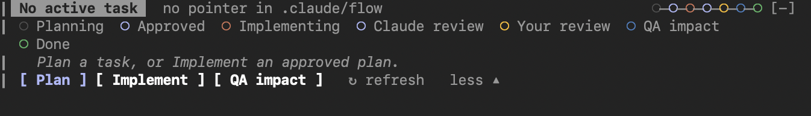

# michaelp-ai-tools

A [Claude Code](https://claude.com/claude-code) plugin marketplace of general-purpose
AI tooling — skills and agents usable in any codebase, by anyone.

## Install

```
/plugin marketplace add MPesin/ai-tools
/plugin install repo-mapper@michaelp-ai-tools
/plugin install design-critic@michaelp-ai-tools
/plugin install dev-flow@michaelp-ai-tools
/plugin install dev-flow-panel@michaelp-ai-tools
```

## Plugins

### repo-mapper — a `/init` replacement that doesn't flood your context

`/init` writes one large `CLAUDE.md` that gets loaded into **every** prompt,
mostly carrying information irrelevant to the task at hand. `repo-mapper`
inverts that: it generates a **project skill** at `.claude/skills/repo-guide/`
— and the mapping pipeline touches no `CLAUDE.md`, `AGENTS.md`, or
`GEMINI.md` at all.

- **A skill costs nothing until used** — until a task triggers it, the
  repo-guide contributes only its one-line description. Its `SKILL.md` index
  is hard-capped at 100 lines: repo purpose, stack, entry points, top
  gotchas, and a routing table telling the agent which reference answers
  which question.
- **Depth is loaded on demand** — `references/` holds self-contained files
  (`architecture.md`, `modules.md`, `symbols.md`, `conventions.md`,
  `commands.md`). A typical task needs the index plus one or two of them.
  The folder is plain markdown — any AI tool can consume it.
- **Indexing is a verified pipeline, not one long prompt** — a scout agent
  surveys the repo and sizes a work plan (you approve the cost before
  fan-out), parallel area-indexer agents each deep-read one subsystem, and an
  auditor verifies citations against the code, resolves convention conflicts,
  and assembles the final skill. Symbols are indexed at *file* granularity —
  line numbers rot too fast to be trustworthy.
- **Git is the only state store** — nothing derivable from git is written:
  no manifest, no stamps, no checksums. A fail-silent SessionStart hook
  derives the index's age from `git log -- .claude/skills/repo-guide` and
  nudges when it drifts: `repo index is 47 commits old — consider /repo-map
  refresh`. Refresh is a full, cost-confirmed regeneration.
- **Nothing runs without consent** — regeneration is never automatic, and
  build/test commands are only executed (to mark `commands.md` entries
  `verified`) if you approve.

- **A thin CLAUDE.md, only if you want one** — `/repo-mapper:init` works
  like `/init` — harvests existing rule files (`.cursorrules`, Copilot,
  Windsurf, Cline, `CONTRIBUTING.md`, an old fat `CLAUDE.md`), explores the
  repo's meta files (CI, PR templates, toolchain files, `.env.example`,
  README setup sections) with a subagent, and fills gaps with one round of
  questions — but keeps only what a skill can't carry: rules an agent must
  know *before its first tool call* (workflow and etiquette conventions,
  hard constraints, environment quirks). Everything the repo-guide already
  covers is dropped with a citation; repo facts it is missing become refresh
  suggestions, never CLAUDE.md lines. You review one proposal before anything
  is written; if nothing survives, no file is written. Requires a current
  repo-guide (it offers to build one first).

Usage: `/repo-map` for a full map, `/repo-map refresh` to update a stale
index, `/repo-mapper:init` for the thin always-loaded `CLAUDE.md`.

### design-critic — an adversarial design reviewer

An agent that reviews plans, specs, and architectures **before** they get
built (not a general critical-thinking aid): it attacks load-bearing
assumptions, hunts silent failure modes and second-run breakage, applies
YAGNI, steelmans a simpler alternative, and returns severity-ranked findings
(CRITICAL / MAJOR / MINOR) ending in a verdict — build as-is, build with
changes, or rethink. Read-only: it never edits or implements.

It verifies claims against reality (reads files, runs read-only commands)
instead of reasoning from the plan text alone, and when missing context would
change the verdict it interviews the author — one batched round of questions
probing intent, never facts it can look up itself. repo-mapper optionally uses
it to review a freshly generated index against the actual code.

This repository's own design was reviewed by it before being built.

### dev-flow — plan, debug, implement, review and QA-impact, run by subagents

Four skills for any project, in any language, on Linux, macOS and Windows
(Git Bash):

- `/dev-flow:dev-plan` writes a plan (interactively with you, or drafted by
  a planner subagent) in a fixed format with verified facts, acceptance
  criteria and steps grouped into **work packages** with disjoint file
  ownership, reviewed by a plan critic before you approve it.
- `/dev-flow:dev-debug` finds the cause of a bug before anyone changes code:
  a clean-slate debugger subagent reproduces it, tests hypotheses against the
  code and git history (read-only; it cannot edit source even to add a print
  statement), and writes a diagnosis with evidence, blast radius and
  confidence. You confirm the root cause, or ask for an independent second
  diagnosis; the confirmed diagnosis becomes a fix plan whose first step is a
  failing regression test, and `dev-implement` takes it from there. Features
  use the planning agents; a bug adds this one agent in front of them.
- `/dev-flow:dev-implement <plan>` runs the plan: independent packages in
  parallel implementer subagents wave by wave, then a review/fix loop where
  every round gets a brand-new reviewer that has seen nothing but the
  requirement and the code, a stop at your review, fixes for your PR
  comments, and finally the QA note. State is files in the task folder, so a
  run resumes after a restart.
- `/dev-flow:dev-qa-impact` writes a fixed-template note for QA engineers who
  do not read code: what changed for users, which regression tests to run,
  and what was built differently from the requirements.

While a flow is active, **hooks enforce what the prompts promise**: no
`git commit/push/checkout/stash/clean`, no posting to PRs or work items
(`gh`, `glab`, `az`, MCP tools), no publishing; read-only agents may write
only their one output file and any other change to the working tree is
detected and reported; implementers may edit only their package's files;
implementers must leave their build/test output in `verify.log` before they
may finish; desktop notifications at the human gates. The guards cover Bash,
PowerShell and MCP tools, run on bash 3.2+ without `jq`, and ship with an
assertion test suite (`bash plugins/dev-flow/hooks/test-hooks.sh`).

### dev-flow-panel — the flow above the prompt

A companion plugin (a hooks module). While a task is active it draws a
two-row band above the prompt: the colour-coded stage read from the task
folder (planning or diagnosing, approved, implementing, Claude review, your
review, QA impact, done, blocked), the task, a progress track, warnings when
findings wait for your decision, and buttons for the four skills. `/dev-flow-panel`
or the band's `more` expands it with the stage list, the hint and the flags.
No pane, so it never takes the height of the terminal; the status line
shows the stage too.



## Repository layout

```
.claude-plugin/marketplace.json    # the marketplace manifest
plugins/repo-mapper/               # 2 commands, skill + references, 3 agents, hook
plugins/design-critic/             # the reviewer agent
plugins/dev-flow/                  # 3 skills, 7 agents, 5 bash hooks + tests
plugins/dev-flow-panel/            # the band (hooks module)
```

## License

[MIT](LICENSE)
