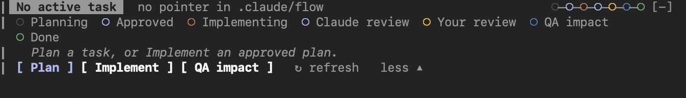

# michaelp-ai-tools

A [Claude Code](https://claude.com/claude-code) plugin marketplace of general-purpose
AI tooling — skills and agents usable in any codebase, by anyone.

## Install

```
/plugin marketplace add MPesin/ai-tools
/plugin install repo-mapper@michaelp-ai-tools
/plugin install design-critic@michaelp-ai-tools
/plugin install lean-talk@michaelp-ai-tools
/plugin install dev-flow@michaelp-ai-tools
/plugin install dev-debug@michaelp-ai-tools
/plugin install dev-flow-panel@michaelp-ai-tools
```

## Plugins

### repo-mapper — a `/init` replacement that doesn't flood your context

`/init` writes one large `CLAUDE.md` that gets loaded into **every** prompt,
mostly carrying information irrelevant to the task at hand. `repo-mapper`
inverts that: it generates a **project skill** at `.claude/skills/repo-guide/`
— and the mapping pipeline touches no `CLAUDE.md`, `AGENTS.md`, or
`GEMINI.md` at all.

- **A skill costs nothing until used** — until a task triggers it, the
  repo-guide contributes only its one-line description. Its `SKILL.md` index
  is hard-capped at 100 lines: repo purpose, stack, entry points, top
  gotchas, and a routing table telling the agent which reference answers
  which question.
- **Depth is loaded on demand** — `references/` holds self-contained files
  (`architecture.md`, `modules.md`, `symbols.md`, `conventions.md`,
  `commands.md`). A typical task needs the index plus one or two of them.
  The folder is plain markdown — any AI tool can consume it.
- **Indexing is a verified pipeline, not one long prompt** — a scout agent
  surveys the repo and sizes a work plan (you approve the cost before
  fan-out), parallel area-indexer agents each deep-read one subsystem, and an
  auditor verifies citations against the code, resolves convention conflicts,
  and assembles the final skill. Symbols are indexed at *file* granularity —
  line numbers rot too fast to be trustworthy.
- **Git is the only state store** — nothing derivable from git is written:
  no manifest, no stamps, no checksums. A fail-silent SessionStart hook
  derives the index's age from `git log -- .claude/skills/repo-guide` and
  nudges when it drifts: `repo index is 47 commits old — consider /repo-map
  refresh`. Refresh is a full, cost-confirmed regeneration.
- **Nothing runs without consent** — regeneration is never automatic, and
  build/test commands are only executed (to mark `commands.md` entries
  `verified`) if you approve.

- **A thin CLAUDE.md, only if you want one** — `/repo-mapper:init` works
  like `/init` — harvests existing rule files (`.cursorrules`, Copilot,
  Windsurf, Cline, `CONTRIBUTING.md`, an old fat `CLAUDE.md`), explores the
  repo's meta files (CI, PR templates, toolchain files, `.env.example`,
  README setup sections) with a subagent, and fills gaps with one round of
  questions — but keeps only what a skill can't carry: rules an agent must
  know *before its first tool call* (workflow and etiquette conventions,
  hard constraints, environment quirks). Everything the repo-guide already
  covers is dropped with a citation; repo facts it is missing become refresh
  suggestions, never CLAUDE.md lines. You review one proposal before anything
  is written; if nothing survives, no file is written. Requires a current
  repo-guide (it offers to build one first).

Usage: `/repo-map` for a full map, `/repo-map refresh` to update a stale
index, `/repo-mapper:init` for the thin always-loaded `CLAUDE.md`.

### design-critic — an adversarial design reviewer

An agent that reviews plans, specs, and architectures **before** they get
built (not a general critical-thinking aid): it attacks load-bearing
assumptions, hunts silent failure modes and second-run breakage, applies
YAGNI, steelmans a simpler alternative, and returns severity-ranked findings
(CRITICAL / MAJOR / MINOR) ending in a verdict — build as-is, build with
changes, or rethink. Read-only: it never edits or implements.

It verifies claims against reality (reads files, runs read-only commands)
instead of reasoning from the plan text alone, and when missing context would
change the verdict it interviews the author — one batched round of questions
probing intent, never facts it can look up itself. repo-mapper optionally uses
it to review a freshly generated index against the actual code.

This repository's own design was reviewed by it before being built.

### lean-talk — lean responses and documents

A skill that keeps every fact and drops every word a reader would skip, in
replies and in documents. `/lean-talk:lean-talk` switches it on for the session.
The rules shape the text as it is written; there is no second pass that
shortens a long draft. `/lean-talk:lean-edit <file>`, or with pasted text,
rewrites text that already exists by the same rules, keeping its headings,
code, links and tables. The rules: whole sentences with their
articles and grammar, every negation and number, names, quotations and code verbatim;
no preamble, hedging, filler or restated heading; the answer first, one idea
per sentence of 20 words or fewer, a paragraph of at most 3 sentences, lists
for parallel items, tables for repeated fields, one sentence per cell, and a
budget per document section. Replies keep to one line per phase around tool
calls and end without a recap. Full sentences anyway for irreversible
actions, warnings and questions to you. Nothing in it is about code: a brief,
a paper or a memo gets the same treatment as a plan or a review.

### dev-flow — plan, implement, review and QA-impact, run by subagents

Skills for any project, in any language, on Linux, macOS and Windows
(Git Bash):

- `/dev-flow:dev-plan` writes a plan (interactively with you, or drafted by
  a planner subagent) in a fixed format with verified facts, acceptance
  criteria and steps grouped into **work packages** with disjoint file
  ownership, reviewed by a plan critic before you approve it.
- `/dev-flow:dev-implement <plan>` runs the plan: independent packages in
  parallel implementer subagents wave by wave, then a review/fix loop where
  every round gets a brand-new reviewer that has seen nothing but the
  requirement and the code, a stop at your review, fixes for your PR
  comments, and finally the QA note. State is files in the task folder, so a
  run resumes after a restart.
- `/dev-flow:dev-qa-impact` writes a fixed-template note for QA engineers who
  do not read code: what changed for users, which regression tests to run,
  and what was built differently from the requirements.
- `/dev-flow:orchestrate` runs the whole flow on autopilot: `dev-plan` (or
  `dev-debug` for a bug) and then `dev-implement`, in one turn, with a
  critical `dev-orchestrator` subagent ruling at every point where the skills
  would stop for you. It judges against the specs and acceptance criteria
  only (every ruling cites a spec line, a decision of yours or a verified
  fact), keeps a requirement-by-requirement conformance matrix, and escalates
  to you what the specs do not settle, anything irreversible, and a spent
  budget. It never pushes or opens the PR unless you said so at the start.
- `/dev-flow:load-flow` picks an existing task up in this session (it lists
  the plans folder with each task's status and which session holds it, then
  hands your choice to the skill its status needs); `/dev-flow:clear-flow`
  switches this session's flow off and leaves the task folder as it is.

While a flow is active, the main session commits each package and fix round
as it goes, and pushes and opens the PR when you ask. **Hooks enforce what the
prompts promise**: no push, pull, PR, branch change or commit from subagents,
no force or tag push, no rebase or `git clean`, no comments, merges or
work-item updates (`gh`, `glab`, `az`, MCP tools), no publishing; read-only agents may write
only their one output file and any other change to the working tree is
detected and reported; implementers may edit only their package's files;
implementers must leave their build/test output in `verify.log` before they
may finish; desktop notifications at the human gates. The guards follow the
session that runs the flow: another Claude Code session on the same checkout,
even in the same folder on the same branch, is not guarded, notified or
blocked by it, and cannot run its stage agents. The guards cover Bash,
PowerShell and MCP tools, run on bash 3.2+ without `jq`, and ship with an
assertion test suite (`bash plugins/dev-flow/hooks/test-hooks.sh`).

### dev-debug — find the cause before anyone changes code

Features are planned; bugs are diagnosed. `/dev-debug:dev-debug` runs a
clean-slate, read-only debugger subagent that reproduces the bug with the
project's own commands, tests hypotheses against the code and git history (it
cannot edit source, not even to add a print statement), and writes
`diagnosis.md`: confidence, reproduction, root cause with evidence, hypotheses
ruled out, blast radius, fix steps and the regression test. You confirm the
root cause, add facts, or ask for an independent second diagnosis that knows
nothing of the first. On `fix` the diagnosis becomes an approved plan whose
first step is the failing regression test, in the same task folder layout
`dev-flow` uses, and `/dev-flow:dev-implement` takes it through implement,
review, your review and the QA note. Works on its own for a diagnosis without
a fix; with `dev-flow` installed, its hooks guard the debugger and the gate.

### dev-flow-panel — the flow above the prompt

A companion plugin (a hooks module). While a task is active it draws a
two-row band above the prompt: the colour-coded stage read from the task
folder (planning, approved, implementing, Claude review, your review, QA
impact, done, blocked; a bug from dev-debug gets its own list with
diagnosing and the confirm-cause gate in front), the task, a progress track,
warnings when findings wait for your decision, and buttons for the dev-flow
and dev-debug skills. `/dev-flow-panel`
or the band's `more` expands it with the stage list, the hint and the flags.
No pane, so it never takes the height of the terminal; the status line
shows the stage too.



(The screenshot predates 0.7.0: the band now has a dim rule and a blank row above it, and a fifth button, Load or Clear.)

## Repository layout

```
.claude-plugin/marketplace.json    # the marketplace manifest
plugins/repo-mapper/               # 2 commands, skill + references, 3 agents, hook
plugins/design-critic/             # the reviewer agent
plugins/lean-talk/                 # 2 skills: lean-talk (write lean), lean-edit (rewrite existing text)
plugins/dev-flow/                  # 6 skills, 8 agents, 6 bash hooks + 2 scripts + tests
plugins/dev-flow-panel/            # the band (hooks module)
```

## License

[MIT](LICENSE)
