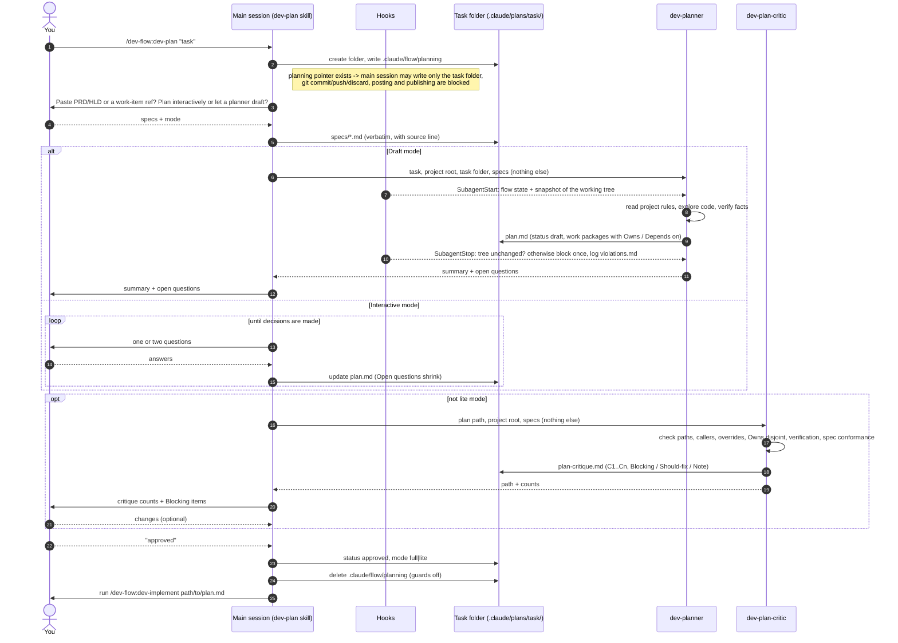
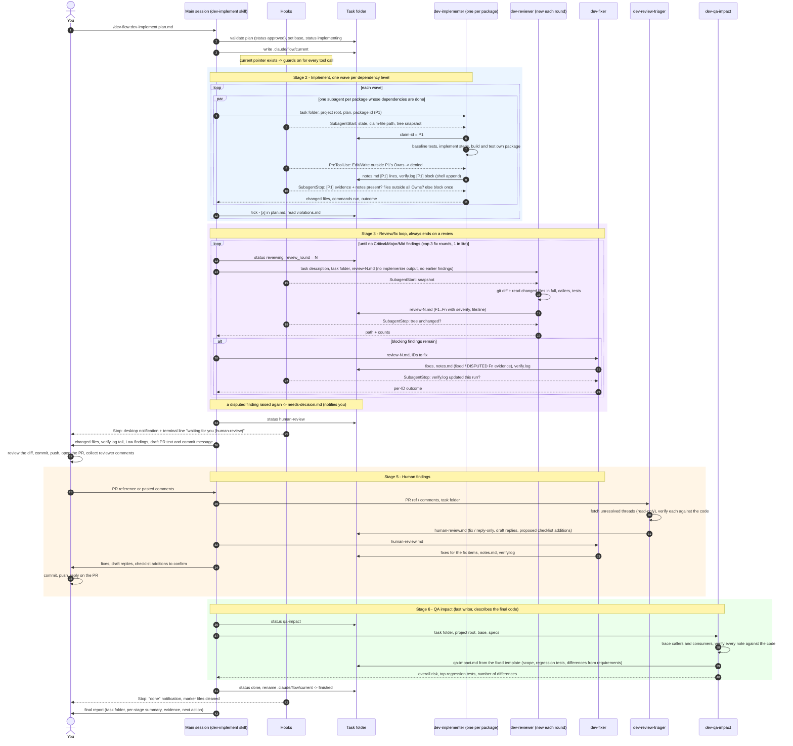

# dev-flow

Plan, implement, review, and QA-impact flow for any project, run by subagents and guarded by hooks. Works on Linux, macOS and Windows (Git Bash).

```
/plugin install dev-flow --marketplace MPesin/ai-tools
```

## Skills

- `/dev-flow:dev-plan` - produce an approved plan (interactive with you, or drafted by a planner subagent), reviewed by a plan critic. Never implements.
- `/dev-flow:dev-implement <plan path>` - implement an approved plan, run the Claude review/fix loop, stop for human review, fix human findings, then produce the QA impact note. State lives as files in the task folder; a run resumes from `status` and `review_round`.
- `/dev-flow:dev-qa-impact` - a fixed-template note for QA engineers who do not read code: what changed for users, which regression tests to run, what was built differently from the requirements. Works from a branch, diff, or PR; no plan needed.

Plans are designed as work packages (disjoint file ownership, explicit dependencies, parallel-safe builds) so `/dev-flow:dev-implement` can run independent packages in parallel subagents, wave by wave.

Plan structure, task folder layout, work packages, pointer files and specs intake are in `skills/dev-implement/plan-format.md`. The QA note template is `skills/dev-qa-impact/qa-impact-template.md`.

The companion plugin `dev-flow-panel` (same marketplace) adds a pane with buttons for the three skills and a coloured view of the current stage.

## How the flow runs

### Planning: `/dev-flow:dev-plan`



"Fix the critique and start implementing" in one reply is handled the same way: the plan is fixed, approved (status, mode, pointer deleted), and then the `dev-implement` skill is invoked, so Intake and the `status: implementing` transition still happen. The guard refuses to spawn any other dev-flow stage agent at that point.

### Implementing: `/dev-flow:dev-implement`



Reading the diagrams: the task folder is the only channel between stages (every subagent prompt carries paths, not content, so the reviewer never sees the implementer's account); the dashed arrows from Hooks are the guards the harness runs, not instructions in the skill text; the `planning` and `current` pointer files switch all of them on and off (except the Agent gate, which then refuses the stage agents until Intake writes `current` again); and only two places wait for you, the approval and the human-review gate, plus anything `needs-decision.md` or `violations.md` raises.

## Agents

`dev-planner`, `dev-plan-critic`, `dev-implementer`, `dev-reviewer`, `dev-fixer`, `dev-review-triager`, `dev-qa-impact`. They carry the flow's hard rules; skills pass only task data and paths.

## What your project's rules file provides

The plugin knows no language, framework, build tool, tracker or hosting platform. Everything project-specific comes from the project's own guidance (CLAUDE.md, AGENTS.md or whatever the project uses), which every agent reads first. A project that wants the most out of the flow states there:

```markdown
## Build and test
- Build: <command>; test: <command>; scope a run to a change by <how>.
- Safe to run side by side (parallel work packages): <commands or "none">.

## Conventions
- Style, naming, comments and test conventions: <rules or a link>.
- Plans location: <path> (default .claude/plans/). Review checklist: <path>.

## Integrations
- Hosting platform: <name>; read-only tool for PR comments: <MCP tool or CLI>.
- Work-item tracker: <name>; read-only tool for fetching an item: <MCP tool or CLI>.
- QA documents are written in <language>.
```

Where the rules file is silent, the agents ask or say so; they do not fall back on defaults of their own.

## Hooks

Active only while `<project>/.claude/flow/current` (implementing) or `planning` exists, except the Agent gate below, which also refuses to start a stage agent when no pointer exists. Delete the pointer file to switch the rest off.

| Hook | What it does |
|---|---|
| PreToolUse on Bash and PowerShell | Blocks `git commit/push/checkout/restore/stash/clean/rebase/merge/reset --hard`, `gh`/`glab`/`az` commands that post or change anything, publishing (`dotnet nuget push`, `npm publish`, `docker push`, ...). Parses the command (quotes, `&&`, `;`, `$()`, wrappers like `sudo`/`timeout`, `bash -c "..."`, `cmd /c "..."`, `wsl`), so `grep "git commit"` passes and `git -C "my repo" push` does not. |
| PreToolUse on `mcp__*` | Blocks MCP tools whose names read like writes (`create_pull_request`, `wit_update_work_item`, `add_issue_comment`, ...). |
| PreToolUse on Edit/Write/NotebookEdit | Reviewer, plan critic, QA and triager may write only their own file in the task folder; the planner only inside the task folder; implementers in package mode only inside their package's `Owns` (after writing a claim file) and never `plan.md`; the main session, while planning, only the task folder. |
| PreToolUse on Agent | Implementer, reviewer, fixer and triager are spawned only at their own plan status (`implementing`; `reviewing`; `reviewing` or `human-review`; `human-review`), and refused while `planning` exists, when no pointer exists, or when `current` names a missing folder or one without `plan.md`, so a flow cannot run with the guards off and the status panel stale. This one runs even without a pointer. Planner, critic and QA are not gated: QA also runs standalone. |
| SubagentStart | Injects the flow state; snapshots the working tree; excludes `.claude/flow/` and `.claude/plans/` from `git status` via `.git/info/exclude`. |
| SubagentStop | Compares the tree with the snapshot: a read-only agent that changed anything, or an implementer that changed files outside every package's `Owns`, is blocked once with the list and the change is appended to `violations.md`. Implementers and fixers must have appended this run's build/test output to `verify.log` (a `[Pn]` block in package mode) and their notes. |
| Stop | At `draft`, `human-review`, `blocked`, `done`, or when `needs-decision.md` / `violations.md` appear: a terminal message and one desktop notification per state (PowerShell toast on Windows and WSL, `osascript` on macOS, `notify-send` on Linux; `DEV_FLOW_NOTIFY_CMD="<program>"` overrides, called with title and message). |
| SessionStart (startup, resume, compact) | Re-injects the active task folder, status and how to continue; warns when the pointer is older than two days. |

The hooks are bash (3.2 or newer, so macOS's `/bin/bash` and Git Bash both work) and need no `jq`. `bash hooks/test-hooks.sh` runs the assertion suite on any of the three systems.

## Do not also keep copies in `~/.claude`

User-level copies of these agents or hooks would duplicate the plugin's and fire the hooks twice.
