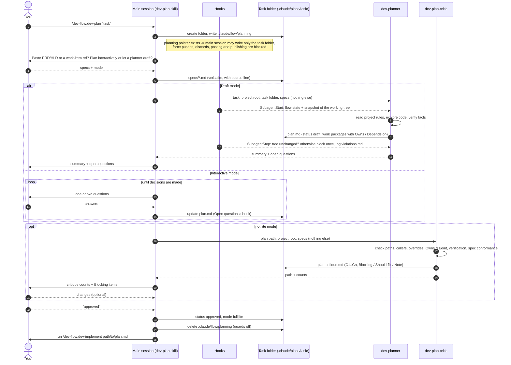

# dev-flow

Plan, implement, review, and QA-impact flow for any project, run by subagents and guarded by hooks. Bugs start in the companion `dev-debug` plugin, whose diagnosis becomes a fix plan this flow implements. Works on Linux, macOS and Windows (Git Bash).

```
/plugin install dev-flow --marketplace MPesin/ai-tools
```

## Skills

- `/dev-flow:dev-plan` - produce an approved plan (interactive with you, or drafted by a planner subagent), reviewed by a plan critic. Never implements.
- `/dev-flow:dev-implement <plan path>` - implement an approved plan (committing each package and each fix round as it goes; it pushes and opens the PR when you ask), run the Claude review/fix loop, stop for human review, fix human findings, then produce the QA impact note. State lives as files in the task folder; a run resumes from `status` and `review_round`.
- `/dev-flow:dev-qa-impact` - a fixed-template note for QA engineers who do not read code: what changed for users, which regression tests to run, what was built differently from the requirements. Works from a branch, diff, or PR; no plan needed.
- `/dev-flow:load-flow [task folder]` - pick up an existing task in this session: lists the task folders under the plans location with their status and which session holds them, and hands the one you choose to the skill its status needs (`dev-plan` for a draft, `dev-debug` for a diagnosis, `dev-implement` from approved on).
- `/dev-flow:clear-flow [all]` - switch this session's flow off: removes its pointer files and the hooks' marker files, nothing else (the task folder and `plan.md` stay, so `load-flow` brings the task back). `all` also removes another session's leftover pointer.

Plans are designed as work packages (disjoint file ownership, explicit dependencies, parallel-safe builds) so `/dev-flow:dev-implement` can run independent packages in parallel subagents, wave by wave.

Plan structure, task folder layout, work packages, pointer files and specs intake are in `skills/dev-implement/plan-format.md`. The QA note template is `skills/dev-qa-impact/qa-impact-template.md`.

The companion plugin `dev-debug` (same marketplace) diagnoses bugs and hands this flow an approved fix plan; `dev-flow-panel` adds a band above the prompt with buttons for both plugins' skills and a coloured view of the current stage.

## How the flow runs

### Planning: `/dev-flow:dev-plan`



"Fix the critique and start implementing" in one reply is handled the same way: the plan is fixed, approved (status, mode, pointer deleted), and then the `dev-implement` skill is invoked, so Intake and the `status: implementing` transition still happen. The guard refuses to spawn any other dev-flow stage agent at that point.


### Implementing: `/dev-flow:dev-implement`

```mermaid
sequenceDiagram
    autonumber
    actor U as You
    participant M as Main session (dev-implement skill)
    participant H as Hooks
    participant F as Task folder
    participant I as dev-implementer (one per package)
    participant R as dev-reviewer (new each round)
    participant X as dev-fixer
    participant T as dev-review-triager
    participant Q as dev-qa-impact

    U->>M: /dev-flow:dev-implement plan.md
    M->>F: validate plan (status approved), set base, commits on/off, status implementing
    M->>U: your own uncommitted work? commit it first / leave it out / no commits
    M->>F: write .claude/flow/current
    Note over H: current pointer exists -> guards on for every tool call

    rect rgb(235, 245, 255)
    Note over M,I: Stage 2 - Implement, one wave per dependency level
    loop each wave
        par one subagent per package whose dependencies are done
            M->>I: task folder, project root, plan, package id (P1)
            H-->>I: SubagentStart: state, claim-file path, tree snapshot
            I->>F: claim-id = P1
            I->>I: baseline tests, implement steps, build and test own package
            H-->>I: PreToolUse: Edit/Write outside P1's Owns -> denied
            I->>F: notes.md [P1] lines, verify.log [P1] block (shell append)
            H-->>I: SubagentStop: [P1] evidence + notes present? files outside all Owns? else block once
            I-->>M: changed files, commands run, outcome
        end
        M->>F: tick - [x] in plan.md, read violations.md
        M->>M: git add -- <package's files>; git commit, one per package
    end
    end

    rect rgb(245, 235, 255)
    Note over M,X: Stage 3 - Review/fix loop, always ends on a review
    loop until no Critical/Major/Mid findings (cap 3 fix rounds, 1 in lite)
        M->>F: status reviewing, review_round = N
        M->>R: task description, task folder, review-N.md (no implementer output, no earlier findings)
        H-->>R: SubagentStart: snapshot
        R->>R: git diff + read changed files in full, callers, tests
        R->>F: review-N.md (F1..Fn with severity, file:line)
        H-->>R: SubagentStop: tree unchanged?
        R-->>M: path + counts
        alt blocking findings remain
            M->>X: review-N.md, IDs to fix
            X->>F: fixes, notes.md (fixed / DISPUTED Fn evidence), verify.log
            H-->>X: SubagentStop: verify.log updated this run?
            X-->>M: per-ID outcome
            M->>M: git add -- <fixed files>; git commit "fix review-N F1, F3"
        end
    end
    Note over M,F: a disputed finding raised again -> needs-decision.md (notifies you)
    end

    M->>F: status human-review
    H-->>U: Stop: desktop notification + terminal line "waiting for you (human-review)"
    M->>U: the run's commits, verify.log tail, Low findings, draft PR text
    U->>M: review the commits; "push and open the PR" (or do it yourself)
    M->>M: git push -u origin HEAD; open the PR with the drafted description
    U->>U: collect reviewer comments

    rect rgb(255, 245, 230)
    Note over M,X: Stage 5 - Human findings
    U->>M: PR reference or pasted comments
    M->>T: PR ref / comments, task folder
    T->>T: fetch unresolved threads (read-only), verify each against the code
    T->>F: human-review.md (fix / reply-only, draft replies, proposed checklist additions)
    M->>X: human-review.md
    X->>F: fixes for the fix items, notes.md, verify.log
    M->>M: git commit "address review comments"
    M->>U: fixes (committed), draft replies, checklist additions to confirm
    U->>M: "push" (or push yourself)
    U->>U: reply on the PR
    end

    rect rgb(235, 255, 235)
    Note over M,Q: Stage 6 - QA impact (last writer, describes the final code)
    U->>M: review done ("everything works", or the panel's QA impact button)
    M->>F: status qa-impact
    M->>Q: task folder, project root, base, specs
    Q->>Q: trace callers and consumers, verify every note against the code
    Q->>F: qa-impact.md from the fixed template (scope, regression tests, differences from requirements)
    Q-->>M: overall risk, top regression tests, number of differences
    end

    M->>F: status done, rename .claude/flow/current -> finished
    H-->>U: Stop: "done" notification, marker files cleaned
    M->>U: final report (task folder, per-stage summary, evidence, next action)
```

Reading the diagrams: the task folder is the only channel between stages (every subagent prompt carries paths, not content, so the reviewer never sees the implementer's account); the dashed arrows from Hooks are the guards the harness runs, not instructions in the skill text; the `planning` and `current` pointer files switch all of them on and off (except the stage gate, which then refuses the stage agents until Intake writes `current` again; see [Guards](#guards)); and only two places wait for you, the approval and the human-review gate, plus anything `needs-decision.md` or `violations.md` raises.

## Agents

`dev-planner`, `dev-plan-critic`, `dev-implementer`, `dev-reviewer`, `dev-fixer`, `dev-review-triager`, `dev-qa-impact`. They carry the flow's hard rules; skills pass only task data and paths.

## Bug fixes from `dev-debug`

Features and changes are planned here. A bug is diagnosed first by the `dev-debug` plugin (`/dev-debug:dev-debug`): its read-only `dev-debugger` agent reproduces the bug and writes `diagnosis.md`; the user confirms the cause; the skill writes an approved `plan.md` with `source: dev-debug` in the same task folder layout and invokes `/dev-flow:dev-implement`. This plugin treats such a plan as a bug fix:

- the implementer writes the regression test first and appends its failing run to `verify.log` before touching code, and stops if the test already passes;
- the reviewer re-derives the cause from the code and checks the change removes it rather than the symptom, and that the same defect does not survive at sibling sites;
- the QA note lists the reported scenario as the first regression test.

The hooks know the debugger too: while `dev-debug` runs under the `planning` pointer with `status: diagnosing`, `dev-debugger` may write only `diagnosis*.md` and `debug/` in the task folder (never source, not even to instrument it), any other change to the working tree is reported, the main session may write only the task folder, and the Stop hook notifies at the diagnosis gate. Without `dev-flow` installed, `dev-debug` still works; only these guards are missing. There is no separate bug-fixer agent: the hooks, the status panel and the review loop all key on `plan.md`, so the fix is a plan like any other.

## What your project's rules file provides

The plugin knows no language, framework, build tool, tracker or hosting platform. Everything project-specific comes from the project's own guidance (CLAUDE.md, AGENTS.md or whatever the project uses), which every agent reads first. A project that wants the most out of the flow states there:

```markdown
## Build and test
- Build: <command>; test: <command>; scope a run to a change by <how>.
- Run the program with an input: <command> (the debugger reproduces bugs with it).
- Safe to run side by side (parallel work packages): <commands or "none">.

## Conventions
- Style, naming, comments and test conventions: <rules or a link>.
- Plans location: <path> (default .claude/plans/). Review checklist: <path>.

## Integrations
- Hosting platform: <name>; read-only tool for PR comments: <MCP tool or CLI>.
- Work-item tracker: <name>; read-only tool for fetching an item: <MCP tool or CLI>.
- QA documents are written in <language>.
```

Where the rules file is silent, the agents ask or say so; they do not fall back on defaults of their own.

## Guards

The skills tell each agent what it may and may not do. The guards are hooks (`hooks/hooks.json`) that enforce those rules regardless of what an agent decides, so a subagent that drifts cannot push a branch or open a PR, nothing in the flow can force-push, post to a PR or merge it, and a reviewer cannot "quickly fix" the code it reviews. The main session, which you talk to, pushes the commits it made and opens the PR when you ask: keeping the remote up to date is yours to decide, not something a guard should stand in the way of.

A refused tool call never runs. Claude Code shows the agent the reason, for example `dev-flow guard: git push is not allowed in a subagent (dev-fixer): the main session pushes, when the user asks`, and the agent adapts: it reports the problem instead of retrying around it. The checks that run when an agent finishes block it once, with the list of what is missing, and the agent then reports. They never loop.

### When the guards are on

The guards follow a **pointer file** in `<project>/.claude/flow/`. Each pointer holds the absolute path of the task folder on its first line and, from 2.5.0, `session: <id>` on the second: the Claude Code session that wrote it.

| Pointer | Written by | Means |
|---|---|---|
| `planning` | `/dev-flow:dev-plan`, `/dev-debug:dev-debug` | a plan is being written or a bug diagnosed (`status: draft` or `diagnosing`) |
| `current` | `/dev-flow:dev-implement` Intake | a plan is being implemented, reviewed or QA'd |
| `finished` | the final report (renamed from `current`) | the run is done; the Stop hook notifies you and removes it |

- **No pointer, no guards.** The one exception is the stage gate (below), which also refuses to start a stage agent when there is no pointer.
- **One session.** The skills write the pointer's first line; a PostToolUse hook in the session that ran that tool call adds the session line right after. The flow then belongs to that session: the guards, the notifications and the session restore apply to it and to the subagents it spawns (their hooks carry the parent session's id), and to nothing else. Another Claude Code session on the same checkout, even in the same folder on the same branch, sees the pointer as absent: it pushes, commits and edits as usual, its own subagents are held to nothing, and it cannot spawn the flow's stage agents (the refusal names the owning session). At start it is told that the flow exists and how to run it from there: `/dev-flow:load-flow` (or the stage's skill: `/dev-flow:dev-implement <plan>`, `/dev-flow:dev-plan <task folder>`, `/dev-debug:dev-debug <task folder>`) writes the pointer again, which hands the flow to that session; the other session's run then loses its guards and cannot spawn further stage agents, while agents it already has running stay guarded until they stop. A `finished` pointer or a `current` at `status: done` left by another session is swept by any session's Stop hook, since that run is over. A pointer without the line (written by hand, or by dev-flow before 2.5.0) belongs to no session until one claims it the same way. A resumed session (`claude --resume`) keeps its id and its flow; a fork, or a fresh session in the same folder, is another session.
- **To switch the guards off, run `/dev-flow:clear-flow`** (it removes this session's pointer files and the hooks' marker files), or delete the pointer file. That abandons the run: the stage agents then cannot be spawned until `/dev-flow:dev-implement` writes `current` again. It is not needed to push or open the PR (the main session may do both), nor to finish (QA impact and the final report end the run and switch the guards off).
- **Lookup.** The pointer is searched from the working directory upwards and the search stops at the first directory holding a `.git`. A session started in a subdirectory still finds the project's flow. A git worktree (Claude Code makes them under `<repo>/.claude/worktrees/<name>`) is its own project: it neither sees nor is guarded by the main checkout's flow.
- **A stale `planning` pointer is not enforced.** That is one left behind once `plan.md` moved past planning (`approved` or later) or whose folder is gone. The hooks say so once per session, with the `rm` command, and the Stop hook removes it once `plan.md` shows the later status. One naming a missing folder is only named, never removed. A pointer at `draft` or `diagnosing` is never touched.
- **A `current` left at `status: done`** (the final rename to `finished` skipped) is finished by the Stop hook all the same, so it cannot leave the guards on for good.
- **Two tasks at once.** A second task can be planned or diagnosed (`planning`) while the first waits at human review (`current`). The planner, critic and debugger then belong to `planning` and the stage agents to `current`.
- **Who is who.** The hooks tell the main session from a subagent, and one subagent from another, by the agent type Claude Code reports. An agent spawned as `general-purpose` (the fallback when a dev-flow agent is missing) counts as a subagent of no known kind: it gets no per-agent write limits, but it still cannot commit.

### 1. Commands (Bash and PowerShell)

Every Bash and PowerShell command is read before it runs.

**git**

| Allowed | Refused |
|---|---|
| everything that reads: `status`, `diff`, `log`, `show`, `blame`, `branch` (list), `stash list/show`, ... | `pull` |
| `push` from the **main session**, when you ask (it pushes the commits the flow made; `-u`, `-o`, `--follow-tags`, `HEAD:<branch>` are fine) | `push` from **any subagent**; a push that overwrites or deletes remote branches, from anyone: `-f`, `--force`, `--force-with-lease`, `--force-if-includes`, `-d`, `--delete`, `--mirror`, `--prune` (and their abbreviations), a `+<ref>` or `:<ref>` refspec |
| `add`, and `reset <path>` (unstage) | `checkout`, `switch`, `restore`, `clean`, `stash` (anything but list/show), `reset --hard/--merge/--keep/--soft` |
| `commit` from the **main session**, which commits each package and fix round (see the dev-implement skill's Commits section) | `commit` from **any subagent**: parallel implementers share one index, so one's `git add` would sweep in another's half-done files |
| | `commit --amend` (and its abbreviations `--am`, `--ame`, `--amen`), and `reset --soft`, which amends in two steps: they rewrite a commit from before the flow, or one a reviewer already saw |
| | `rebase`, `merge`, `cherry-pick`, `revert`, `am`, `filter-branch`, `filter-repo`, `commit-tree`, `update-ref`, `replace`; `branch -d/-D/-m/-M/-f` |
| | `-c alias.<name>=...` on the command line. An alias from git config (`git ci`) is looked up and checked as what it runs, so `ci = commit` from a subagent and `fp = push --force` are refused |

**Hosting platforms and publishing**

| Tool | Allowed | Refused |
|---|---|---|
| `gh` | `pr view/list/diff/checks/status`, `issue view/list`, `repo view/clone`, `run view/watch`, other `list`/`view`; `api` with a plain GET; `pr create` from the main session | everything else that creates, edits, comments, merges, approves or deletes; `pr create` from a subagent; `api` with `-X POST/PATCH/...`, `-f`/`-F` fields or `--input` |
| `glab` | `mr view/list/diff`, `issue view/list`, `ci view/list/status/lint/trace`, ...; `api` GET; `mr create` from the main session | the same writes as `gh` |
| `az` | `repos pr list/show`, `boards work-item show`, other list/show; `devops invoke` GET; `repos pr create` from the main session | updating PRs, creating them from a subagent, work items, repos, pipeline runs, builds, releases, variables |
| package and image publishing | building, testing, restoring packages | `dotnet nuget push/delete`, `nuget push`, `npm publish/unpublish/deprecate`, `yarn`/`pnpm publish`, `docker push`, `cargo publish`, `twine upload`, `gem push`, `helm push`, `mvn deploy`, `gradle publish*` |

**How a command is read.** A command is split into simple commands at `;`, `&&`, `|`, `$(...)`, backticks and newlines. Quoted text stays an argument, heredoc bodies are skipped, and case is ignored. Wrappers (`sudo`, `env X=1`, `timeout`, `nohup`, `xargs`, `Start-Process`, ...) are looked through, and so is a quoted or Windows path to the program (`"C:\Program Files\Git\bin\git.exe"`). Commands handed to another shell (`bash -c "..."`, `cmd /c "..."`, `pwsh -Command "..."`, `wsl ...`, `eval`) are read too, two levels deep. So:

- `grep -rn "git push" docs/`, `echo remember to git push` and a heredoc that mentions `git push` all pass;
- `git -C "my repo" push -f`, `npm test && git push --force`, `sudo env X=1 git push -f` and `cmd /c "git push -f"` are all refused, and so is any of them without `-f` from a subagent.

### 2. MCP tools

An MCP tool (`mcp__<server>__<tool>`) is refused when its name reads like a write to an outside system. That means a name with a word such as `create`, `update`, `delete`, `add`, `post`, `comment`, `reply`, `resolve`, `merge`, `push`, `submit`, `approve`, `assign`, `close`, `edit`, `set`, `transition`, `publish`, `upload`, `send`, `move` or `archive`, for example `merge_pull_request`, `add_issue_comment` or `wit_update_work_item`. The one exception is opening a PR or MR from the main session (`create_pull_request`, `create_merge_request`, `repo_create_pull_request`), as with `gh pr create`; from a subagent it is refused too. Tools that read (`get_pull_request`, `search_code`, `list_issues`) pass. The check goes by name only, so a read tool with a write-like word in its name is refused too. Read the same data through `git`, `gh` or `az` instead.

### 3. File writes (Edit, Write, NotebookEdit)

Each agent may write only what its stage produces. "Task folder" is the folder the pointer names.

| Agent | May write | Notes |
|---|---|---|
| main session, while planning (`planning`) | the task folder and `.claude/flow/` | planning never touches source |
| main session, while implementing (`current`) | anything | it orchestrates; it ticks `plan.md` boxes and commits |
| `dev-planner` | the task folder | |
| `dev-plan-critic` | `plan-critique.md` | |
| `dev-reviewer` | `review-*.md` | never fixes what it reviews |
| `dev-review-triager` | `human-review.md` | |
| `dev-qa-impact` | `qa-impact.md` | |
| `dev-debugger` | `diagnosis*.md` and files under `debug/` | never source, not even to instrument it |
| `dev-implementer`, plan without packages | anything except other stages' files (below) | ticks `plan.md` itself |
| `dev-implementer`, plan with packages | its package's `Owns` paths, plus the task folder (claim `all`: anything) | must first write its package id (`P2`, or `all`) to the claim file it is given; never edits `plan.md` (the main session ticks it); appends to `notes.md` with `>>`, so parallel appends cannot overwrite each other |
| `dev-fixer` | anything except other stages' files and `plan.md` | |

The **other stages' files** are `verify.log`, `review-*.md`, `plan-critique.md`, `qa-impact.md`, `human-review.md`, `needs-decision.md` and `violations.md`. An implementer or fixer may not change them with Edit/Write. `verify.log` is only appended to, with a shell `>>`, so earlier evidence cannot be rewritten.

This guard sees the Edit/Write tools only. A file written by a shell command (`echo x > src/a.cs`, a build that rewrites a lock file) is caught afterwards by the working-tree check (5).

### 4. Stage gate (spawning agents)

`/dev-flow:dev-implement` sets `status` in `plan.md` before each stage. The hooks and the status panel read that status, and the gate keeps it truthful: a stage agent can be spawned only at its own status.

| Agent | Spawned only at `status` |
|---|---|
| `dev-implementer` | `implementing` |
| `dev-reviewer` | `reviewing` |
| `dev-fixer` | `reviewing` or `human-review` |
| `dev-review-triager` | `human-review` |

They are also refused:
- when there is no pointer at all (run `/dev-flow:dev-implement <plan>`, not the agent directly);
- while a genuine `planning` pointer exists (the refusal names the plan's status and the skill to finish first; a plan at `diagnosing` points at `/dev-debug:dev-debug`);
- when `current` names a missing folder or a folder without `plan.md`.

`dev-planner`, `dev-plan-critic`, `dev-debugger` and `dev-qa-impact` are not gated. They run during planning, standalone, or under another task's pointer, and their writes are limited by guard 3.

### 5. Working-tree check (agent start and stop)

When a dev-flow agent starts, the hooks take a snapshot of the working tree: every changed and untracked path with a hash of its content. When the agent stops, they take another and compare the two. This catches changes made by any means, including shell commands and build side effects. A path listed differently at stop is checked against the file itself, so a file whose content did not change is never reported. That covers files committed meanwhile, and files pushed out of a listing longer than the limit.

| Agent | A changed file is a violation when |
|---|---|
| read-only agents (planner, critic, reviewer, triager, QA, debugger) | any file outside the task folder and `.claude/flow/` changed |
| `dev-implementer` in a package | it is outside **every** package's `Owns` (a parallel package's file is not a violation) |
| single `dev-implementer`, `dev-fixer` | never (they may change any source file) |

A violation is appended to `violations.md` in the task folder with the agent and the files. The agent is blocked once with the list and told to report exactly what it changed and why, not to revert it. The main session then stops and shows it to you, and you decide whether to keep or revert the changes. Nothing is reverted automatically.

Limits:
- The snapshot holds the first 5,000 changed and untracked paths. `git status` lists changed tracked files first, so those are always included. An existing untracked file past the limit that the agent changes is caught only by its modification time (it counts when modified after the start snapshot). Keep generated caches (for example `graphify-out/`) out of the listing with `.gitignore` or `.git/info/exclude`.
- A path with a newline in its name is not supported.
- The snapshot hook has a 120 s timeout. If it is cut off, no snapshot is written. The stop then skips the comparison and tells you in the terminal that the check did not run for that agent, so you can check its changes with `git status` and `git diff`.

### 6. Evidence check (implementer and fixer stop)

An implementer or fixer cannot finish without proof that it built and tested its own work. At its stop it is blocked once, with what is missing, when:

- `verify.log` is missing or empty, or was not appended to during this run (an implementer with no build or test to run appends one line saying so and why);
- in package mode, `verify.log` has no `[Pn]` block for its package, or `notes.md` has no `[Pn]` lines;
- a single implementer leaves unchecked `- [ ]` steps in `plan.md` with nothing in `notes.md` explaining them.

### 7. Notifications and session restore

These do not refuse anything; they keep you and a restarted session informed.

- **Stop.** When the flow waits for you, you get a terminal line and one desktop notification per state. That covers the diagnosis (`diagnosing`, then `confirm-cause`), plan approval (`draft`), `human-review`, `blocked`, `done`, and whenever `needs-decision.md` or `violations.md` has entries. Notifications use a PowerShell toast on Windows and WSL, `osascript` on macOS and `notify-send` on Linux. Set `DEV_FLOW_NOTIFY_CMD="<program>"` to use your own; it is called with the title and message. The Stop hook also removes a stale `planning` pointer and finishes a `finished` (or `done`) run, removing its marker files; it sweeps another session's finished run the same way, silently. A pointer no session has claimed (written by hand, or by dev-flow before 2.5.0) guards nothing anywhere, so the Stop hook says so once per session, with the `/dev-flow:load-flow` call that claims it.
- **SessionStart** (startup, resume, clear, compact). It puts this session's active task folder, status, mode, review round and base back into context with how to continue, and names a parked second task. It warns when the pointer is more than two days old (the flow may be abandoned) and when `needs-decision.md` or `violations.md` have items. A pointer of another session, or one no session has claimed, is named instead, with `/dev-flow:load-flow` to run that flow from this session and `/dev-flow:clear-flow all` to clear a leftover.
- **PostToolUse** (Bash, PowerShell, Write, Edit, NotebookEdit; main session only). After a tool call that can have written a pointer (the Write or Edit tool on a pointer's path; a shell command that names the flow directory and writes there: a redirect to `current`, `planning` or `finished`, `tee`, `cp`, `mv`, `Set-Content` and the like), a pointer without a session line gets this session's: that is the moment a flow becomes this session's, right after the skill writes the pointer. A read (`cat`, `ls`) claims nothing, and a pointer that already names a session is left alone.
- **SubagentStart.** It gives each dev-flow agent the task folder, project root, branch and plan status, and tells it its own allowance (the claim file for a package implementer, `verify.log` for writing agents). It also adds `.claude/flow/` and `.claude/plans/` to `.git/info/exclude`, so the flow's own files stay out of `git status` and out of commits.

### What the guards do not cover

- **Scripts are not read.** `./release.sh` that runs `git push` inside is not refused; only the command line itself (and the git aliases it uses) is read.
- **The main session is not write-limited while implementing.** It is the orchestrator; only its commands are checked.
- **A single implementer and the fixer may change any source file.** Package implementers are held to their `Owns`.
- **Shell writes are detected, not prevented.** A read-only agent that writes with a shell command is reported when it stops, not stopped when it writes.
- **No pointer, no guards** (except the stage gate). `/dev-flow:clear-flow`, or deleting the pointer, abandons the run: the deliberate way out when you want the run stopped, not a step for pushing or finishing.
- **Other sessions are not guarded.** A flow in one session does not stop another Claude Code session on the same checkout from pushing or changing the branch the flow works on. Sessions are kept apart on purpose; two flows that must not share a working tree belong in separate git worktrees. The one thing the other session gets is a warning, once per session, the first time it runs a git command that switches branches, discards or rewrites changes (`checkout`, `switch`, `restore`, `reset`, `stash`, `clean`, `rebase`, `merge`, `cherry-pick`, `revert`, `pull`, `worktree`) while another session's flow is active there: such a command would also move or lose that flow's uncommitted work. The command still runs.

### Running the tests

The hooks are bash (3.2 or newer, so macOS's `/bin/bash` and Git Bash on Windows both work) and need no `jq`. `bash hooks/test-hooks.sh` runs the assertion suite on Linux, macOS and Windows.

## Do not also keep copies in `~/.claude`

User-level copies of these agents or hooks would duplicate the plugin's and fire the hooks twice.
